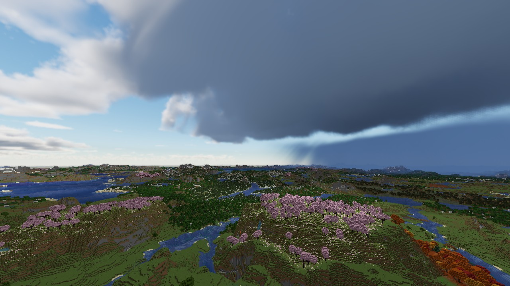
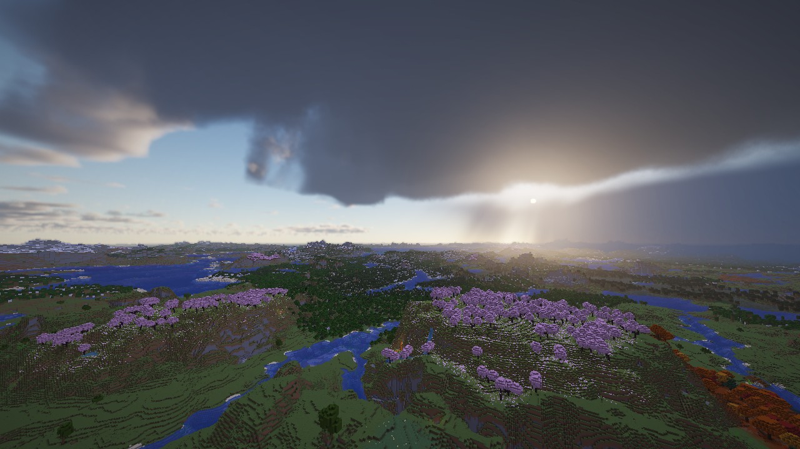
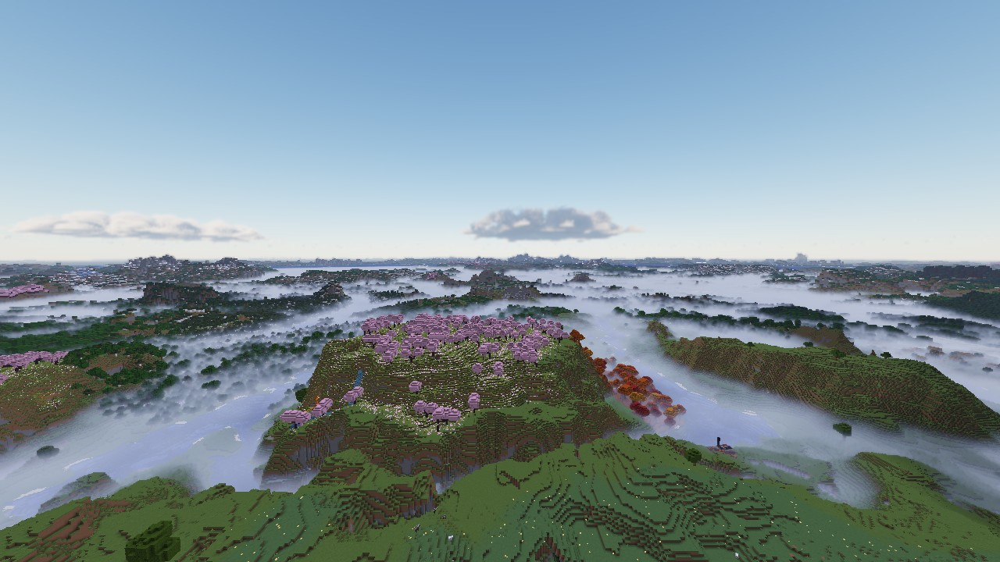
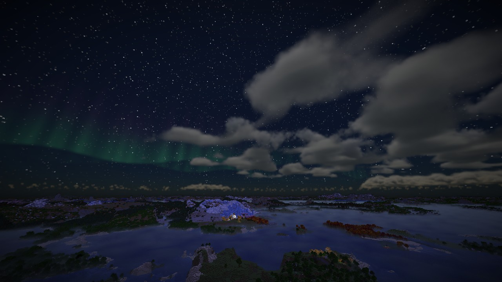
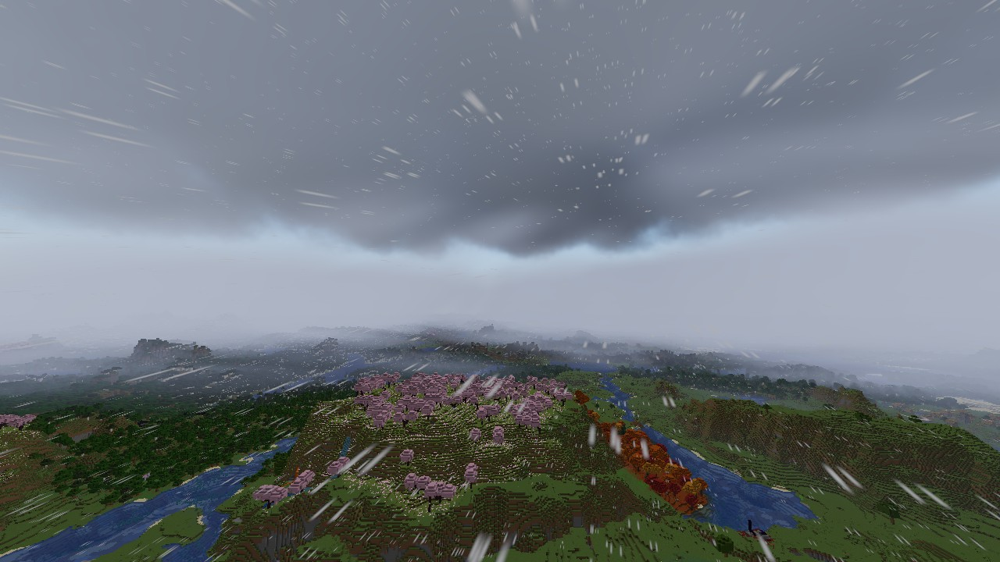
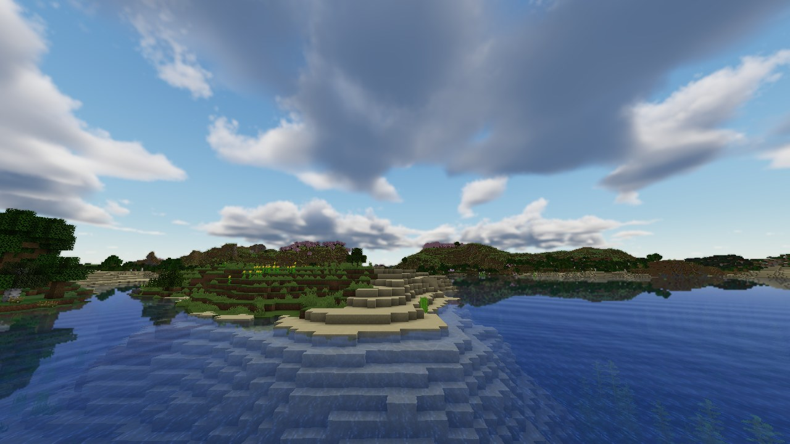
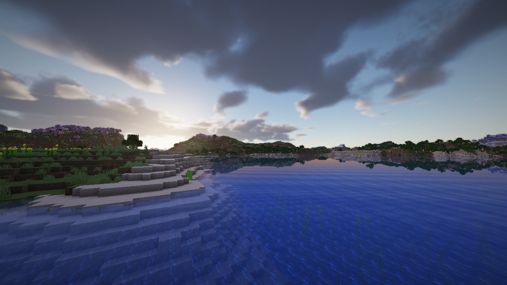

# Big Skies - Dynamic Weather and Atmospherics
Big skies is a mod that adds atmospheric dynamic weather based on climate across all biomes. Leveraging rust ability to run very optimised shaders; Big Skies draws raytraced clouds and beautiful atmospheric effects across the world. 

Clouds form based on local weather. River valleys have morning fog, storms form in humid air and last over night. Snow falls on peaks and cold biomes with overcast skies. The mod completely revamps the way weather works in minecraft moving away from the global weather to an immersive atmospheric experience.

Compatibility
Big skies runs both as a client side mod for multiplayer and as a configurable one for singleplayer. In singleplayer or hosted servers with the mod running you can control the weather with commands and creative tools allowing for easy timelapses and sandbox experimentation when running in multiplayer it defaults to a client side state replacing existing weather for you only.

Two add-ons for [Horizon](https://github.com/horizon-rust/horizon), made to go together and fine apart:

| | Kind | What it does |
| --- | --- | --- |
| **[Big Skies](skies/)** | native mod (`big_skies`) | Regional, dynamic weather at real scale: storms you can watch from kilometres away, fronts, showers, valley fog, volumetric clouds under a physical sky, distance-aware thunder, northern lights, mist and spray rainbows at waterfalls. |
| **[Natural Lighting](natural-lighting/)** | shader pack (`natural_lighting`) | Soft sun and moon shadows, smooth torchlight, water with waves, reflections, clear shallows and caustics, sunrays and a soft bloom. With Big Skies, passing clouds dim the light and fade the shadows. |



| | |
| --- | --- |
|  |  |
|  |  |

Natural Lighting:

| | |
| --- | --- |
|  |  |

## Install

From Horizon's mod browser (launcher > Mods) once they are listed there, or by hand:

- **Big Skies:** put `big_skies.hnmod` (from the [releases](../../releases)) in the game home's `horizon-native-mods/`
  folder (launcher > Mods > Open folder) and build. Native mods are compiled into the game and are not sandboxed,
  so trusting one is your call; the whole source is here. Then, in the game's options, turn **Clouds**, **Fog** and
  **Weather** off (the mod draws its own) and **LOD Distance** up to at least 512.
- **Natural Lighting:** put `natural_lighting.hshader` (or the `natural-lighting` folder) in the game's `shaderpacks`
  folder and pick it in Options > Video Settings > Shaders.

Big Skies 0.3.0 is built for Horizon Nightly 2026-11-08 (`fdc87ae`); Natural Lighting needs shader API 0.1
(Nightly 2026-11-08 or later).

Release files are signed with [minisign](https://jedisct1.github.io/minisign/); the public key is in
[minisign.pub](minisign.pub):

```
minisign -Vm big_skies.hnmod -p minisign.pub
```

## Build

```
python skies/tools/build_native.py            # skies/dist/big_skies.hnmod
horizon-shader pack natural-lighting --out dist/natural_lighting.hshader
```

## License

MIT, see [LICENSE](LICENSE). Big Skies' native build adapts Orbital Laser's
([Stink-O/orbital-laser](https://github.com/Stink-O/orbital-laser), MIT); see [skies/NOTICE](skies/NOTICE) for that
and for the published rendering work the sky and clouds are based on.
